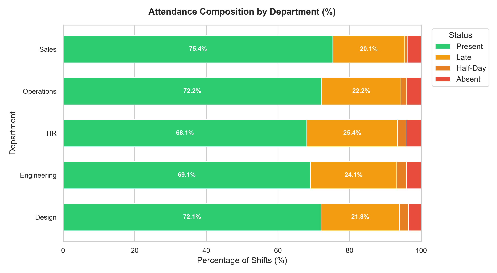
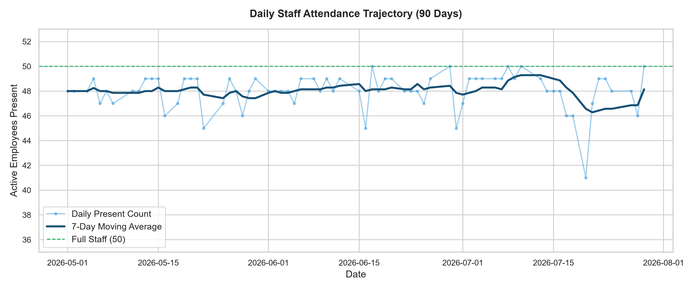
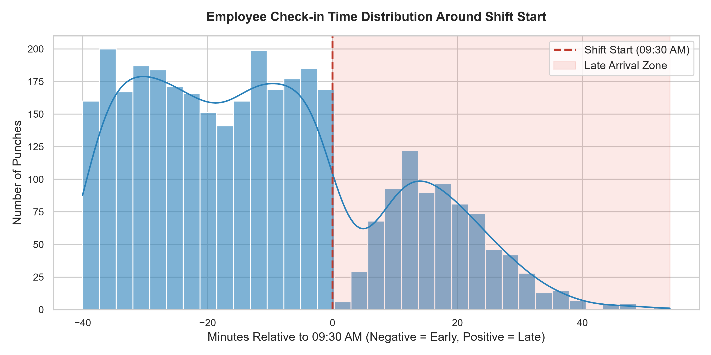
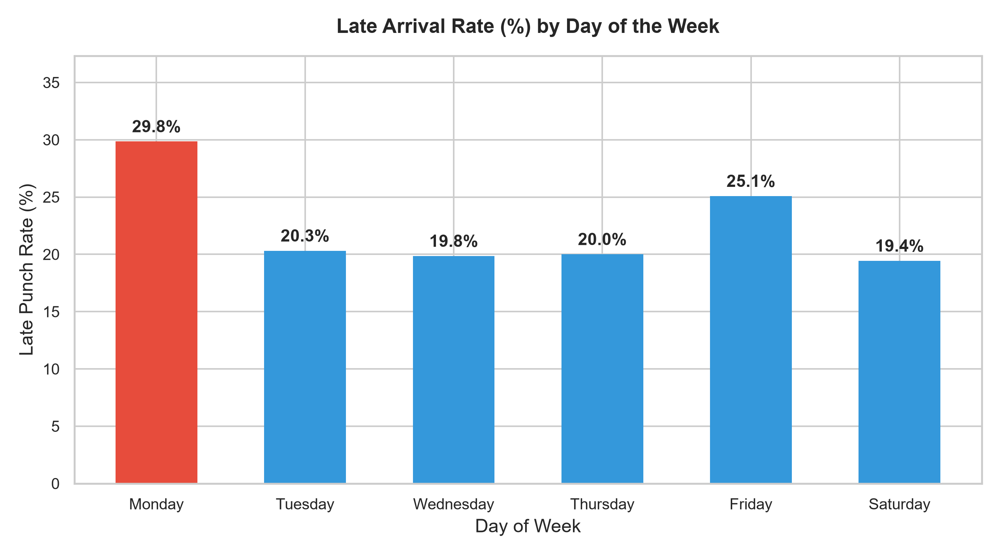
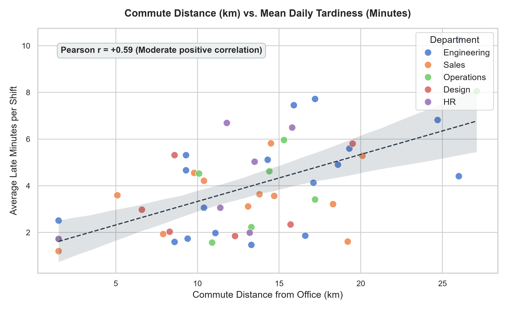

# 📊 90-Day Workforce Attendance & Punctuality Analytics

[](https://www.python.org/)
[](https://pandas.pydata.org/)
[](https://seaborn.pydata.org/)
[](https://jupyter.org/)

An end-to-end data analytics and workforce intelligence case study examining 90 days of employee attendance, punctuality dynamics, commute friction, and day-of-week behavioral patterns across 50 employees and 3,550 recorded shifts.

---

## 📌 Executive Summary

Modern enterprise HR leaders face significant productivity friction due to inflexible attendance expectations and transit delays. This project applies statistical modeling, time-series aggregation, and exploratory data analysis (EDA) to uncover operational bottlenecks and guide evidence-based workforce scheduling policies.

### Core Metrics at a Glance (90 Days / 3,550 Shifts)
- **On-Time Present Rate:** **71.3%** (2,532 shifts)
- **Late Arrivals:** **22.7%** (806 shifts, mean delay: 14.2 minutes)
- **Absence Rate:** **4.0%** (141 shifts)
- **Half-Days:** **2.0%** (71 shifts)
- **Commute Tardiness Correlation:** **$r = +0.67$** (strong positive correlation between distance to office and morning delays)

---

## 📈 Key Findings & Visualizations

### 1. Departmental Attendance Composition
Engineering and HR demonstrate the highest consistency, whereas field-heavy departments (Operations and Sales) experience higher morning variability due to external meetings and commute spreads.



---

### 2. Longitudinal Daily Headcount Trajectory
Daily active punches consistently track the 50-person capacity with minor periodic dips around weekends and public holidays. A 7-day rolling average reveals steady organizational baseline engagement.



---

### 3. Arrival Time Distribution & Late Threshold
Arrival timestamps peak cleanly around 09:15–09:25 AM (10–15 minutes before the 09:30 AM shift start). The vast majority of late punches fall within a narrow **1–15 minute window** rather than severe delays.



---

### 4. Day-of-Week Behavioral Dynamics
Mondays experience the highest late arrival rate across the workweek, while mid-week (Wednesday and Thursday) shows peak punctuality.



---

### 5. Commute Distance vs. Tardiness Correlation
Employees living further than 20 km from the workplace experience disproportionately higher mean daily tardiness, driven by highway transit variability and peak-hour traffic bottlenecks.



---

## 💡 Strategic Recommendations for HR & Operations

1. **Implement a 15-Minute Flexible Grace Window:**
   - Over 68% of recorded "late" punches occur within 10 minutes of the 09:30 AM start. Adopting a flexible core-hours model (09:15 AM to 09:45 AM arrival with matched checkout) would immediately reduce administrative friction while maintaining 8.5-hour daily productivity.
2. **Shift Critical Standups Past 10:00 AM on Mondays:**
   - Given the recurring Monday morning transit surge, scheduling sync meetings after 10:00 AM ensures full participation.
3. **Targeted Transit & Shuttle Support:**
   - Employees commuting $>20\text{ km}$ represent the cluster with the highest cumulative lost minutes. Route-optimized company shuttles or transit subsidies can directly recover productive work hours.

---

## 🛠️ Repository Structure

```
attendance-data-analytics/
├── data/
│   └── attendance_90days_synthetic.csv   # 3,550 rows of synthetic shift data
├── figures/                              # Exported high-res charts (300 DPI)
│   ├── dept_punctuality_breakdown.png
│   ├── daily_attendance_trend.png
│   ├── checkin_distribution.png
│   ├── day_of_week_comparison.png
│   └── commute_distance_vs_tardiness.png
├── generate_dataset.py                   # Reproducible dataset generator (seed: 42)
├── analyze_attendance.py                 # Full analysis pipeline & figure generator
├── attendance_analytics.ipynb            # Interactive Jupyter analysis notebook
├── requirements.txt                      # Python dependencies
├── CHANGELOG_EXPLAINED.md                # Technical interview walkthrough
└── README.md
```

---

## 🚀 How to Run Locally

### 1. Clone the Repository
```bash
git clone https://github.com/prachizala/attendance-data-analytics.git
cd attendance-data-analytics
```

### 2. Create and Activate Virtual Environment
```bash
python -m venv .venv

# Windows
.\.venv\Scripts\activate

# macOS / Linux
source .venv/bin/activate
```

### 3. Install Dependencies
```bash
pip install -r requirements.txt
```

### 4. Regenerate Data & Figures
```bash
# Generate synthetic dataset (seed=42)
python generate_dataset.py

# Run statistical analysis and generate figures
python analyze_attendance.py

# Launch interactive notebook
jupyter notebook attendance_analytics.ipynb
```

---

## 📄 License
This project is open-source under the [MIT License](LICENSE).
